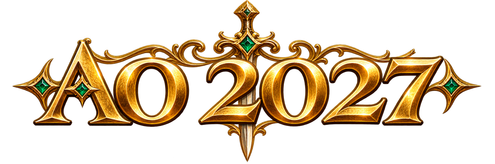

<p align="center">
  
</p>

<h1 align="center">AO 2027</h1>

<p align="center">
  Argentum Online de escritorio. Explorá el mundo, armá tu clan y elegí tu facción.
</p>

<p align="center">
  <a href="https://github.com/Ayrton09/AO-2027/releases/latest"><strong>Descargar el juego</strong></a>
  · <a href="docs/HOSTING.md">Guía de hosting</a>
  · <a href="https://github.com/Ayrton09/AO-2027/issues">Reportar un problema</a>
</p>

## Jugar

| Sistema | Descarga | Cómo abrirlo |
| --- | --- | --- |
| **Windows** | [Instalador](https://github.com/Ayrton09/AO-2027/releases/latest/download/CoverAO-Setup.exe) | Ejecutá el instalador y abrí la app. |
| **Linux** | [AppImage](https://github.com/Ayrton09/AO-2027/releases/latest/download/CoverAO-x86_64.AppImage) | Dale permiso de ejecución y abrí el archivo. |

Abrí **Servidores** en el menú, agregá la dirección que te pasó quien hostea y entrá. Si el servidor corre en tu propia PC con la configuración de fábrica, usá `http://localhost:7669/`. Al abrir la dirección desde el navegador vas a ver la página de descarga.

Si venís de CoverAO 1.0.8 o anterior, descargá AO 2027 una vez desde esta página. En Windows, instalalo sobre tu instalación anterior. En Linux, podés reemplazar el AppImage. A partir de ahí la app busca **actualizaciones firmadas** en este repositorio al abrirse.

## Qué hay en el mundo

- **Facciones y clanes.** Combatí por la Armada Imperial, el Caos o la Milicia Republicana y progresá en sus rangos.
- **Oficios y comercio.** Recolectá materiales, fabricá equipo y vendé en subastas.
- **Aventuras.** Explorá pueblos y mazmorras, peleá contra criaturas o jugadores y cruzate con bots que entrenan, hacen oficios y comercian.
- **Cliente de escritorio.** Gráficos HD, iluminación, clima y música por mapa.

## Hostear un servidor

Descargá el paquete autocontenido para [Windows](https://github.com/Ayrton09/AO-2027/releases/latest/download/CoverAO-servidor-win-x64.zip) o [Linux](https://github.com/Ayrton09/AO-2027/releases/latest/download/CoverAO-servidor-linux-x64.tar.gz), descomprimilo y arrancá con `Servidor.bat` o `bash servidor.sh`, respectivamente. El servidor incluido trae su propio runtime .NET.

La [guía de hosting](docs/HOSTING.md) cubre `Server.ini`, puertos, HTTPS, Docker, copias de seguridad y actualización del servidor. Podés conservar la configuración y el mundo en `data/` al actualizar. Para ofrecer a tus jugadores el código exacto de tu servidor, configurá `[INIT] CodigoFuente` con el enlace a la versión que estás ejecutando.

## Trabajar con el código

AO 2027 continúa el servidor **CoverAO-2021**, una variante de Argentum Online escrita en Visual Basic 6. El servidor actual usa C# y .NET 10. El cliente de escritorio usa Electron, TypeScript, Canvas y WebSocket.

Con el SDK de .NET 10 instalado:

```sh
dotnet build CoverAO.slnx -c Release
dotnet server/src/CoverAO.Server/bin/Release/net10.0/CoverAO.Server.dll --web-root client-web
```

Para trabajar con la app, usá `npm ci` y `npm start` en [`desktop/`](desktop/). Los paquetes oficiales incluyen el cliente firmado. Consultá la [guía de hosting](docs/HOSTING.md) para firmar el cliente de tu propia compilación.

| Carpeta | Contenido |
| --- | --- |
| [`server/`](server/) | Mundo, persistencia, bots y protocolo de juego |
| [`desktop/`](desktop/) | Lanzador, lista de servidores y actualizador firmado |
| [`client-web/`](client-web/) | Interfaz del juego y recursos que entrega el servidor |
| [`gamedata/`](gamedata/) | Mapas, criaturas, objetos y reglas |
| [`hosting/`](hosting/) | Empaquetado, configuración y publicación de releases |

Los reportes y las propuestas van en [Issues](https://github.com/Ayrton09/AO-2027/issues). Para cambios de código usá [Pull Requests](https://github.com/Ayrton09/AO-2027/pulls). Si reportás un error, incluí la versión, qué hiciste y qué pasó.

## Licencia y créditos

El código se publica bajo [AGPL-3.0](LICENSE). Los gráficos, sonidos, mapas y demás recursos heredados se documentan por separado en [Créditos](CREDITOS.md), junto con los autores y los proyectos de origen.
